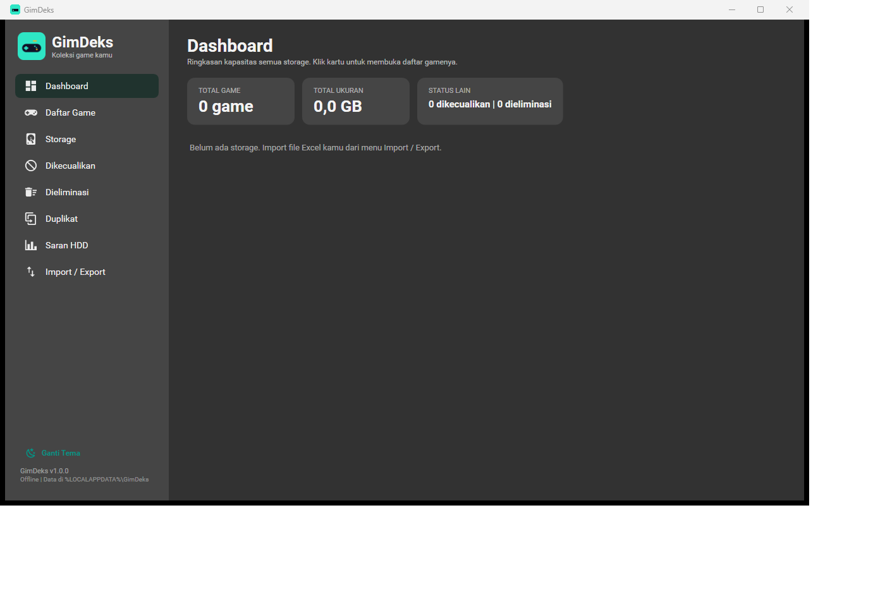
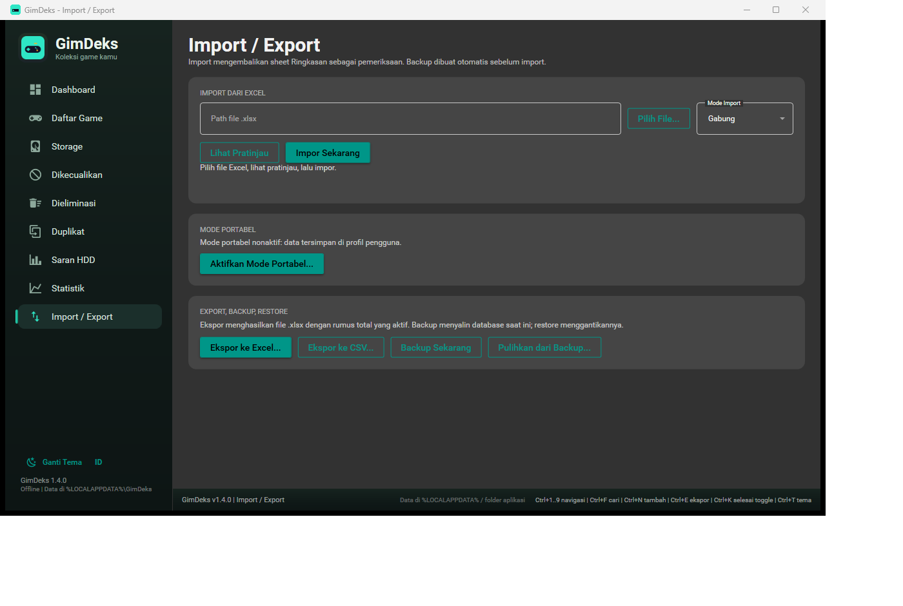

<div align="center">
  
  <h1>GimDeks: Pengelola Koleksi Game untuk Pengguna Excel</h1>
  <p><b>Pantau koleksi game di semua drive dengan hitungan kapasitas otomatis,<br/>batas per HDD, dan import/export Excel sekali klik. Offline secara bawaan.</b></p>
  <a href="https://github.com/nekonaru/gimdeks/releases/latest"></a>
  <a href="https://github.com/nekonaru/gimdeks/actions/workflows/ci.yml"></a>
  <a href="https://github.com/nekonaru/gimdeks/releases/latest"></a>
  <a href="https://github.com/nekonaru/gimdeks/releases/latest"></a>
  <a href="LICENSE"></a>
  
</div>

<br />

[English](README.md) | **Bahasa Indonesia**

> [!NOTE]
> GimDeks dirancang untuk satu orang yang mengelola koleksi game pribadinya di sebuah PC Windows. Aplikasi ini menggantikan spreadsheet Koleksi_Game.xlsx: membaca dan menulis file yang sama persis. Aplikasi ini bekerja sepenuhnya offline; satu-satunya fitur jaringan adalah pengambilan cover Steam yang bersifat opsional.

---

## Daftar Isi

- [Tentang](#tentang)
- [Tangkapan Layar](#tangkapan-layar)
- [Fitur](#fitur)
- [Kebutuhan](#kebutuhan)
- [Instalasi](#instalasi)
- [Cara Pakai](#cara-pakai)
- [Sumber Data](#sumber-data)
- [Struktur Proyek](#struktur-proyek)
- [Pengembangan](#pengembangan)
- [Pengujian](#pengujian)
- [Keamanan](#keamanan)
- [Continuous Integration](#continuous-integration)
- [FAQ](#faq)
- [Penulis](#penulis)
- [Lisensi](#lisensi)

---

## Tentang

GimDeks mengelola koleksi game di banyak drive (HDD eksternal, HDD laptop, dan SSD laptop) dan menghitung ulang setiap total secara otomatis. File Excel lama kamu (Koleksi_Game.xlsx) bisa diimport sekali klik dengan pratinjau lengkap, lalu diexport kembali dengan tata letak yang sama dan rumus total yang aktif.

> _"Rak game kamu, tanpa spreadsheet."_

---

## Tangkapan Layar

<div align="center">
  
  
</div>

*Dashboard saat pertama dibuka, sebelum koleksi diimport (kiri), dan layar Import / Export (kanan).*

---

## Fitur

### Import dan export Excel

| Fitur | Deskripsi |
| --- | --- |
| **Import sekali klik** | Membaca format Koleksi_Game.xlsx (semua sheet, dua budaya desimal angka) dalam waktu kurang dari satu detik. |
| **Pratinjau import** | Menampilkan storage yang terdeteksi, jumlah game, sheet yang dilewati, dan peringatan sebelum data disimpan. |
| **Dua mode import** | `Gabung` (gabung, lewati duplikat) atau `Ganti Semua` (ganti seluruhnya, backup otomatis dibuat dulu). |
| **Pemeriksaan Ringkasan** | Setelah import, jumlah dan total GB tiap storage dibandingkan dengan sheet Ringkasan; selisihnya ditampilkan. |
| **Export Excel** | Menulis kembali format yang sama: satu sheet per storage dengan baris rumus aktif, plus sheet Ringkasan, Dikecualikan dan Game Dieliminasi. |
| **Export CSV** | Seluruh koleksi diexport ke CSV UTF-8 dengan BOM (dipisah titik koma): datanya sama, plus nama storage dan daftar tag. |
| **Aman bolak-balik** | Export lalu import ulang menghasilkan data yang sama. Dicakup oleh test. |
| **Impor dengan drag and drop** | Seret Koleksi_Game.xlsx ke mana pun di jendela: path terisi otomatis dan pratinjau terbuka. |

### Mengelola koleksi

| Fitur | Deskripsi |
| --- | --- |
| **Dashboard** | Satu kartu per storage: jumlah game, total GB, sisa ruang, progress bar, dan lencana peringatan saat melebihi batas. |
| **Daftar Game** | Tabel yang bisa diurutkan, dicari, dan difilter (status, storage, rentang ukuran) dengan virtualisasi untuk ribuan game. |
| **CRUD dengan multi-pilih** | Tambah, ubah, hapus, pindah antar storage, dan ubah status dalam jumlah banyak dengan konfirmasi. |
| **Klik dua kali untuk ubah** | Klik dua kali baris game untuk membuka editornya. |
| **Tandai selesai secara massal** | Pilih beberapa game sekaligus dan centang flag selesai untuk semuanya, langsung dari toolbar. |
| **Pilihan acak** | Bingung mau main apa? Dashboard memilih salah satu game Sudah Ada yang belum selesai secara acak dan menyorotnya di daftar game. |
| **Pemindai game terpasang** | Pindai drive atau folder untuk file `.exe` lokal dan tautkan ke game yang belum punya path peluncuran. Pemindaian hanya membaca file dan tidak pernah menjalankan program. |
| **Pemeriksaan** | Satu halaman memindai storage yang over limit, drive terputus, duplikat, game ukuran nol, backup lama, dan file Excel hilang, dengan tautan langsung ke perbaikannya. |
| **Peluncur lokal** | Simpan path `.exe` game lokal dan luncurkan dari toolbar atau menu klik kanan. Jumlah main dan waktu terakhir dicatat. |
| **Kelola storage** | Tambah dan ubah storage: kapasitas, batas per drive (default 900 GB untuk HDD eksternal 1 TB), dan tipe. |
| **Peringatan melebihi batas** | Storage yang totalnya melewati batas menampilkan lencana peringatan. Tepat di batas tetap aman. |
| **Dikecualikan dan Dieliminasi** | Layar khusus untuk game online/mobile/gratis dan game yang dieliminasi, dengan pemulihan ke storage. |
| **Deteksi duplikat** | Menemukan game kembar (huruf besar-kecil, tanda baca, dan nomor versi diabaikan) dan menyelesaikan per grup. |
| **Pemisahan versi** | Satu aksi memisahkan versi di akhir nama seperti `v1.7` ke kolom Versi. |
| **Halaman Statistik** | Total koleksi, porsi per storage, 10 game terbesar, rata-rata ukuran, dan kemajuan penyelesaian. |
| **Tag dan penyelesaian** | Tag buatan sendiri, dipisah koma, dan tanda selesai per game; keduanya bisa difilter; statistik penyelesaian ada di halaman statistik. |
| **Saran pembagian HDD** | Mengusulkan urutan download yang memasukkan game Belum Download ke HDD tanpa melewati batas. |
| **Riwayat** | Setiap perpindahan antar storage tercatat dan ditampilkan per storage. |
| **Pintasan keyboard** | `Ctrl+1` sampai `Ctrl+9` ganti halaman, `Ctrl+F` cari, `Ctrl+N` tambah game, `Ctrl+E` export, `Ctrl+T` ganti tema. |

### Pengalaman aplikasi

| Fitur | Deskripsi |
| --- | --- |
| **Offline secara bawaan** | Satu file SQLite di `%LOCALAPPDATA%\GimDeks`. Tanpa akun, tanpa telemetri, tanpa panggilan jaringan wajib. |
| **Backup dan restore** | Backup database sekali klik (atau otomatis sebelum import) dan restore dari salinan `.db`. |
| **Tema gelap dan terang** | Bisa diganti dari sidebar; pilihan kamu diingat. |
| **Mode portabel** | Satu tombol memindahkan folder data ke sebelah aplikasi; database dan pengaturan ikut berpindah bersama drive eksternal. |
| **Cover Steam (opsional)** | Mencari game di Steam dan mengunduh header art-nya sebagai cover; yang dikirim hanya judul game, dan tidak ada yang terjadi tanpa klik kamu. |
| **Antarmuka dua bahasa** | Bahasa Indonesia atau Inggris, diganti dari sidebar; pilihan kamu diingat. Angka mengikuti bahasa yang aktif di layar; database tetap memakai penyimpanan invariant. |
| **Aman secara bawaan** | Tidak ada perubahan yang menimpa tanpa backup dan konfirmasi; hapus selalu minta izin dulu. |

---

## Kebutuhan

### Untuk menjalankan (build jadi)

| Dependensi | Versi Minimum | Catatan |
| --- | --- | --- |
| **Windows** | 10 versi 1809 atau lebih baru, atau Windows 11 | x64 |
| **.NET runtime** | Tidak perlu | Exe rilis bersifat self-contained |
| **Koleksi_Game.xlsx** | File Koleksi_Game.xlsx dengan format asli | Hanya untuk kebutuhan import |

> [!TIP]
> Pengguna yang tidak ingin build dari source bisa mengunduh `GimDeks-win-x64.zip` dari [rilis terbaru](https://github.com/nekonaru/gimdeks/releases/latest).

### Belum pernah pakai terminal? Mulai dari sini

<details><summary><b>Membuka terminal di Windows</b></summary>

1. Tekan `Win + R`.
2. Ketik `powershell` lalu tekan Enter.
3. Jendela biru terbuka. Kamu sudah bisa mengetik perintah.
4. Tutup dengan `exit` atau tombol X.

</details>

### Untuk membangun dari source

| Dependensi | Versi Minimum | Catatan |
| --- | --- | --- |
| **Windows** | 10/11 | Dibutuhkan oleh WPF |
| **.NET SDK** | 10.0 | Membangun proyek `net10.0` |
| **Git** | 2.x | Untuk clone repo |

---

## Instalasi

### Opsi A: Unduh executable (paling mudah)

1. Buka halaman [rilis terbaru](https://github.com/nekonaru/gimdeks/releases/latest).
2. Unduh `GimDeks-win-x64.zip` lalu ekstrak ke mana pun (berisi `GimDeks.exe` dan folder `assets`; simpan keduanya bersama-sama).
3. Jalankan `GimDeks.exe`. Tidak perlu instalasi.
4. Data kamu berada di `%LOCALAPPDATA%\GimDeks`. Salin folder itu untuk backup manual.

> [!IMPORTANT]
> Windows SmartScreen mungkin memperingatkan karena binary tidak ditandatangani. GimDeks adalah open source; kamu bisa membaca kodenya di GitHub atau membangunnya sendiri (Opsi B).

### Opsi B: Build dari source (untuk pengembangan / membaca atau mengubah kode)

#### 1. Ambil kode

<details><summary><b>Saya sudah punya Git</b></summary>

```bash
git clone https://github.com/nekonaru/gimdeks.git
cd gimdeks
```

</details>

<details><summary><b>Saya belum punya Git</b></summary>

1. Buka https://github.com/nekonaru/gimdeks di browser.
2. Klik `Code` lalu `Download ZIP`.
3. Ekstrak ZIP dan buka foldernya.

</details>

#### 2. Build dan verifikasi

> [!IMPORTANT]
> Solution menargetkan .NET 10. Restore harus selesai tanpa error.

```bash
dotnet restore GimDeks.slnx
dotnet test GimDeks.slnx
```

#### 3. Build dan jalankan aplikasi

```bash
dotnet build src/GimDeks.App -c Release
dotnet run --project src/GimDeks.App
```

---

## Cara Pakai

### Menjalankan pertama kali

1. Buka GimDeks. Kamu langsung ke Dashboard (kosong pada awalnya).
2. Klik `Import / Export` di sidebar.
3. Klik `Pilih File...` dan pilih `Koleksi_Game.xlsx` kamu.
4. Klik `Lihat Pratinjau` dan periksa ringkasannya (10 storage, 169 game, baris verifikasi bertanda Cocok).
5. Klik `Impor Sekarang`. Backup dibuat otomatis dulu.
6. Kembali ke `Dashboard`. Semua storage dan totalnya sudah ada.

> [!NOTE]
> Import dengan `Ganti Semua` menghapus koleksi yang ada sebelum mengimport. Import dengan `Gabung` mempertahankan game yang ada dan melewati duplikat. Backup selalu dibuat sebelum import apapun.

### Pemakaian sehari-hari

- **Dashboard**: klik kartu storage mana pun untuk membuka daftar game-nya.
- **Daftar Game**: cari, filter berdasarkan status/storage/ukuran, tambah, ubah, hapus, pindah, atau ubah status game, termasuk multi-pilih. Klik dua kali untuk membuka editornya. Pilihan kamu bertahan saat refresh.
- **Storage**: kelola kapasitas dan batas, lihat statistik per storage dan riwayat pemindahan, atau pindahkan banyak game sekaligus.
- **Dikecualikan / Dieliminasi**: simpan game online dan yang dihapus di luar hitungan kapasitas; pulihkan ke storage saat kembali.
- **Duplikat**: temukan game yang mirip dan hapus atau tandai sebagai Dieliminasi per grup.
- **Saran HDD**: dapatkan plan urutan pengisian HDD yang menjaga tiap HDD di bawah batas.
- **Drag and drop impor**: seret `Koleksi_Game.xlsx` ke mana pun di jendela. Path terisi otomatis dan pratinjau terbuka.
- **Export**: tulis koleksi kembali ke `.xlsx` dengan format asli dan rumus aktif.
- **Bahasa**: klik tombol `ID` / `EN` di sidebar kiri bawah untuk mengganti seluruh antarmuka antara Bahasa Indonesia dan Inggris. Pilihan kamu diingat.

---

## Sumber Data

| Tujuan | Sumber |
| --- | --- |
| Data koleksi game | `Koleksi_Game.xlsx` kamu (file lokal, diimport oleh kamu) |
| Status aplikasi | Database SQLite di `%LOCALAPPDATA%\GimDeks\gimdeks.db` |
| Backup | `%LOCALAPPDATA%\GimDeks\backups\gimdeks-backup-*.db` |
| Pengaturan | `%LOCALAPPDATA%\GimDeks\settings.json` (ukuran jendela, tema, bahasa) |
| Cover | `%LOCALAPPDATA%\GimDeks\covers\` (hanya jika kamu mengunduh cover Steam) |

> [!NOTE]
> GimDeks bekerja sepenuhnya offline. Satu-satunya panggilan jaringan opsional adalah pengambilan cover Steam, dan hanya terjadi saat kamu secara eksplisit meminta cover untuk game yang kamu miliki. Yang dikirim hanya judul game.

---

## Struktur Proyek

```
gimdeks/
  GimDeks.slnx                    # solution
  assets/                         # aset merek (mark, icon, lockup)
  src/
    GimDeks.App/                  # aplikasi WPF (Views, ViewModels, DI, Resources/)
    GimDeks.Core/                 # model, aturan, interface (tanpa WPF, tanpa SQLite)
    GimDeks.Data/                 # SQLite, repository, migrasi, backup
    GimDeks.Excel/                # importer/exporter Excel
  tests/
    GimDeks.Tests/                # test xUnit (import, aturan kapasitas, roundtrip)
  .github/workflows/              # pipeline CI dan rilis
  README.md                       # dokumentasi bahasa Inggris
  README.id.md                    # terjemahan Bahasa Indonesia (file ini)
```

---

## Pengembangan

### Menambah string antarmuka

1. Tambahkan atau pakai kunci `Ui_`. Kunci yang sama, urutan yang sama, ada di `src/GimDeks.App/Resources/Strings.id.xaml` dan `Strings.en.xaml`.
2. Pakai `{DynamicResource Ui_KunciKamu}` di XAML, atau baca di kode dengan `Services.Loc.Get("Ui_KunciKamu")` / `Services.Loc.Format`.
3. Periksa aplikasi dalam dua bahasa sebelum commit. Jangan letakkan logika di code-behind; gunakan view model.

### Mengubah skema

1. Tambahkan migrasi baru ke `src/GimDeks.Data/DatabaseInitializer.cs`; jangan pernah mengubah migrasi yang sudah ada.
2. Naikkan target `PRAGMA user_version` lalu tambahkan test.

### Mengubah tata letak import/export

1. Baca dulu `src/GimDeks.Excel/ExcelImporter.cs` dan `ExcelExporter.cs`.
2. Pertahankan aturan "baca berdasarkan pola, bukan posisi".
3. Perbarui test roundtrip jika semantics berubah.

> [!WARNING]
> File yang dihasilkan (`.g.cs`, `.baml`) di dalam `obj/` dibangun ulang otomatis. Jangan diedit manual.

---

## Pengujian

Singkatnya: test memakai xUnit dan berada di `tests/GimDeks.Tests`. Cakupan: matematika kapasitas (termasuk batas tepat 900 GB), parsing desimal di budaya invariant dan id-ID, importer (dengan workbook in-memory), roundtrip export, dan migrasi skema.

```bash
dotnet test GimDeks.slnx
```

| Pemeriksaan | Syarat |
| --- | --- |
| Unit test | Semua lulus |
| Analyzer / linter | Nol error |
| Build (Release) | Nol error |
| Gerbang coverage di CI | Minimal 75% line coverage pada Core/Data/Excel |

Konfigurasi lint memakai set default C#; solution ter-build tanpa warning.

---

## Keamanan

GimDeks offline secara bawaan: tidak membuat panggilan jaringan sama sekali kecuali kamu secara eksplisit mengambil cover Steam, dan panggilan itu hanya mengirim judul game yang kamu pilih. Koleksi game kamu tetap di PC dalam satu file SQLite di `%LOCALAPPDATA%\GimDeks`, dan setiap import selalu didahului backup database otomatis. Dependensi diaudit di CI dan workflow rilis; secret dipindai sebelum setiap perubahan di-merge. Binary rilis tidak ditandatangani; verifikasi unduhan `GimDeks-win-x64.zip` terhadap `SHA256SUMS.txt`, atau bangun sendiri dengan Opsi B di atas.

> [!NOTE]
> Untuk melaporkan kerentanan secara privat, gunakan jalur di [`SECURITY.md`](SECURITY.md).

---

## Continuous Integration

| Workflow | Fungsi |
| --- | --- |
| `.github/workflows/ci.yml` | Restore, build Release, test dengan coverage, audit dependensi, secret scan |
| `.github/workflows/release.yml` | Pada tag `v*`: test, publish single-file self-contained `win-x64`, paket zip, buat release notes dari changelog, lampirkan ke GitHub Release |

Branch utama dilindungi: CI wajib lulus dan owner merge dengan 0 approval wajib (repo single-maintainer). Rilis hanya dibuat dari tag yang hijau.

---

## FAQ

<details><summary><b>Di mana data saya disimpan?</b></summary>

```
%LOCALAPPDATA%\GimDeks\gimdeks.db
%LOCALAPPDATA%\GimDeks\settings.json
%LOCALAPPDATA%\GimDeks\backups\
```

Salin seluruh folder untuk memindahkan semuanya ke PC lain.

</details>

<details><summary><b>Apakah akan merusak file Excel saya?</b></summary>

Tidak. Import hanya membaca file; export menulis file baru di lokasi yang kamu pilih. File asli kamu tidak pernah diedit.

</details>

<details><summary><b>Bisakah saya mengimport Koleksi_Game.xlsx yang sudah ada?</b></summary>

Bisa. Gunakan file dengan format asli. Importer mendeteksi sheet berdasarkan pola isi dan melaporkan sheet yang dilewati di layar Pratinjau.

</details>

<details><summary><b>Angka tampil 32,2 di layar tapi 32.2 di file. Apakah bug?</b></summary>

Bukan. Di layar angka memakai budaya bahasa UI yang aktif (format Indonesia dengan koma desimal di Bahasa Indonesia, format Inggris di bahasa Inggris). Di file dan database memakai budaya invariant. Parsing menangani keduanya.

</details>

<details><summary><b>Kenapa butuh WebView/font gratis/jaringan?</b></summary>

Tidak butuh. GimDeks bekerja sepenuhnya offline. Satu-satunya panggilan jaringan adalah pengambilan cover Steam yang opsional, dan hanya saat kamu mengklik untuk mengambil cover. Semuanya berjalan di mesin kamu.

</details>

<details><summary><b>Apakah GimDeks ada di Windows Store?</b></summary>

Belum. Unduh zip rilis dari GitHub sebagai gantinya.

</details>

---

## Penulis

<div align="center">

| [](https://github.com/nekonaru) |
|:---:|
| **[Nicolas Dwi Dharma](https://github.com/nekonaru)** |

</div>

---

## Lisensi

Didistribusikan di bawah **MIT License**. Lihat [`LICENSE`](LICENSE) untuk informasi lebih lanjut.
